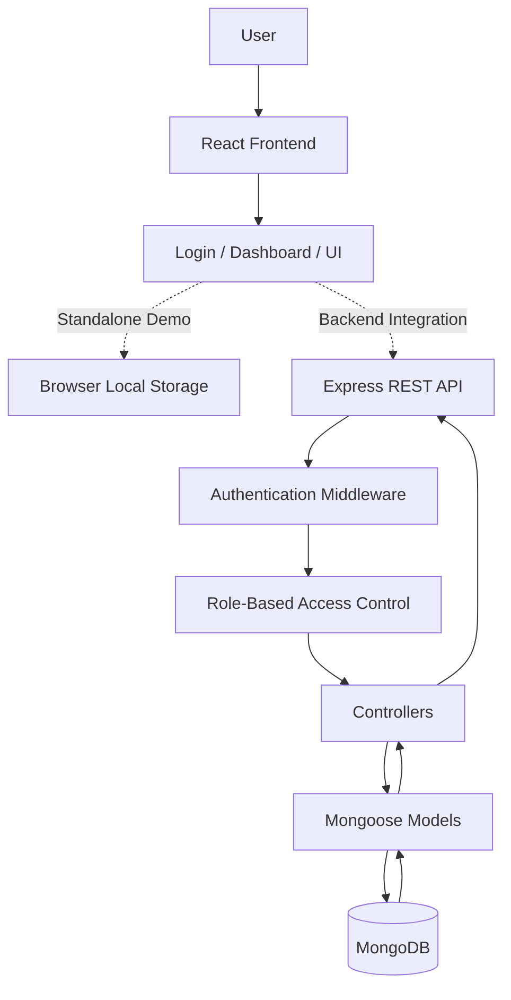

# 🎓 CampusConnect – College Management Dashboard

CampusConnect is a modern, responsive college management system designed to simplify campus administration and academic management. It includes a React-based dashboard with a standalone demo frontend and a separate Express.js backend API integrated with MongoDB for authentication, user management, academic records, and announcements.

The project demonstrates a full-stack architecture with a modern user interface, REST APIs, database integration, authentication, and role-based access control.

---

## ✨ Features

### Frontend
- Responsive React dashboard built using Vite.
- Modern and user-friendly interface.
- Login and student registration pages.
- Dashboard with sample campus information.
- Reusable React components.
- Responsive design for desktop and mobile.
- Standalone frontend demo with browser-local storage.
- Sample student account for demonstration.

### Backend
- REST API built with Express.js.
- MongoDB database integration.
- Secure password hashing.
- JWT-based authentication using HttpOnly cookies.
- Role-based access control.
- Login and registration rate limiting.
- Student, faculty, and administrator management.
- Department and course management.
- Attendance and marks management.
- Timetable management.
- Audience-based announcements.
- Dashboard API.
- Health-check endpoint.

---

## 🛠️ Tech Stack

| Category | Technologies |
|---|---|
| Frontend | React.js, Vite, JavaScript |
| Styling | CSS |
| Backend | Node.js, Express.js |
| Database | MongoDB, Mongoose |
| Authentication | JWT, HttpOnly Cookies |
| Security | Password Hashing, Rate Limiting, RBAC |
| API | REST API |
| Testing | Node.js Test Runner |
| Development Tools | Git, GitHub, VS Code, npm |

---

## 📁 Project Structure

```text
CampusConnect/
│
├── frontend/
│   ├── src/
│   │   ├── components/       # Reusable UI components
│   │   ├── pages/            # Login, registration, dashboard
│   │   ├── data/             # Sample campus data
│   │   └── styles/           # CSS and responsive styling
│   ├── public/
│   ├── package.json
│   └── vite.config.js
│
├── backend/
│   ├── routes/               # API routes
│   ├── controllers/           # Request handling logic
│   ├── models/               # MongoDB models
│   ├── middleware/            # Authentication and authorization
│   └── ...
│
├── .env.example
├── package.json
└── README.md
```

*Note: The exact backend folder structure may vary depending on the implementation.*

---

## 🚀 Getting Started

### Prerequisites

Install the following:

- [Node.js 20 or newer](https://nodejs.org/)
- npm
- Git

The frontend demo does not require MongoDB or backend configuration.

---

## 💻 Running the Frontend Demo

The frontend is currently standalone and uses sample data. It does not connect to the backend API or MongoDB.

### Step 1: Clone the repository

```bash
git clone https://github.com/YOUR_USERNAME/CampusConnect.git
```

```bash
cd CampusConnect
```

### Step 2: Navigate to frontend

```bash
cd frontend
```

### Step 3: Install dependencies

```bash
npm install
```

### Step 4: Start the development server

```bash
npm run dev
```

### Step 5: Open the application

Open the local URL displayed in your terminal, usually:

```text
http://localhost:5173
```

### Demo Login

| Field | Value |
|---|---|
| Email | aarav.sharma@campus.edu |
| Password | Any password with at least 6 characters |

You can also create a student account through the registration page.

> Demo accounts and sessions are stored locally in the browser. This demo does not provide real authentication. Do not enter real passwords or sensitive personal information.

---

## 🗄️ Backend Setup

The backend is a separate Express.js API that supports authentication, database persistence, and campus management functionalities.

### Prerequisites

- Node.js 20+
- MongoDB 6+ (Local installation or MongoDB Atlas)

### Step 1: Install root dependencies

From the project root:

```bash
npm install
```

### Step 2: Configure environment variables

Create a `.env` file in the repository root using `.env.example`.

```bash
cp .env.example .env
```

On Windows PowerShell, you can use:

```powershell
Copy-Item .env.example .env
```

### Step 3: Configure MongoDB

Set your MongoDB connection string inside `.env`.

For local MongoDB:

```env
MONGODB_URI=mongodb://127.0.0.1:27017/campusconnect
```

For MongoDB Atlas, use your Atlas connection string.

### Step 4: Configure environment variables

Example configuration:

```env
NODE_ENV=development
PORT=3000

MONGODB_URI=mongodb://127.0.0.1:27017/campusconnect

JWT_SECRET=replace_with_a_long_random_secret_at_least_32_characters
JWT_EXPIRES_IN=8h

COOKIE_SECURE=false

CLIENT_ORIGIN=http://localhost:3000

ADMIN_NAME=Administrator
ADMIN_EMAIL=admin@campus.edu
ADMIN_PASSWORD=replace_with_a_secure_password
```

> Never commit your actual `.env` file, database credentials, JWT secrets, or administrator password to GitHub.

### Step 5: Start MongoDB

Ensure your local MongoDB service is running, or verify that your Atlas database is accessible.

### Step 6: Start the backend

From the repository root:

```bash
npm start
```

The backend API runs on:

```text
http://localhost:3000
```

Health check:

```text
http://localhost:3000/api/health
```

---

## 🔐 Authentication & Security

The backend includes:

- Password hashing before storing credentials.
- JWT-based session authentication.
- HttpOnly authentication cookies.
- SameSite cookie protection.
- Login and registration rate limiting.
- Role-based authorization.
- Protected API endpoints.
- Department and course-level access restrictions.
- Environment-based configuration.

### User Roles

| Role | Permissions |
|---|---|
| Student | Access personal academic records and student dashboard |
| Faculty | Manage assigned course records and faculty-related functionality |
| Admin | Manage users, departments, courses, records, and announcements |

---

## 📡 REST API Endpoints

All API responses are returned in JSON format.

Authenticated requests use the HttpOnly cookie:

```text
campusconnect_token
```

### Authentication

| Method | Endpoint | Description |
|---|---|---|
| POST | `/api/auth/register` | Register a student or faculty |
| POST | `/api/auth/login` | Login |
| POST | `/api/auth/logout` | Logout |
| GET | `/api/auth/me` | Get current user |
| PATCH | `/api/auth/me` | Update current profile |

### User Management

| Method | Endpoint | Access |
|---|---|---|
| GET | `/api/users` | Admin |
| POST | `/api/users` | Admin |
| PATCH | `/api/users/:id` | Admin |
| DELETE | `/api/users/:id` | Admin |

### Departments

| Method | Endpoint | Access |
|---|---|---|
| GET | `/api/academics/departments` | Authenticated users |
| POST | `/api/academics/departments` | Admin |
| PATCH | `/api/academics/departments/:id` | Admin |
| DELETE | `/api/academics/departments/:id` | Admin |

### Courses

| Method | Endpoint | Access |
|---|---|---|
| GET | `/api/academics/courses` | Authenticated users |
| POST | `/api/academics/courses` | Admin |
| PATCH | `/api/academics/courses/:id` | Admin |
| DELETE | `/api/academics/courses/:id` | Admin |

### Attendance

| Method | Endpoint | Access |
|---|---|---|
| GET | `/api/records/attendance` | Role-scoped |
| POST | `/api/records/attendance` | Role-scoped |
| PATCH | `/api/records/attendance/:id` | Role-scoped |
| DELETE | `/api/records/attendance/:id` | Role-scoped |

### Marks

| Method | Endpoint | Access |
|---|---|---|
| GET | `/api/records/marks` | Role-scoped |
| POST | `/api/records/marks` | Role-scoped |
| PATCH | `/api/records/marks/:id` | Role-scoped |
| DELETE | `/api/records/marks/:id` | Role-scoped |

### Timetable

| Method | Endpoint | Access |
|---|---|---|
| GET | `/api/records/timetable` | Authenticated users |
| POST | `/api/records/timetable` | Admin |
| PATCH | `/api/records/timetable/:id` | Admin |
| DELETE | `/api/records/timetable/:id` | Admin |

### Announcements

| Method | Endpoint | Access |
|---|---|---|
| GET | `/api/announcements` | Audience-scoped |
| POST | `/api/announcements` | Faculty/Admin |
| PATCH | `/api/announcements/:id` | Admin |
| DELETE | `/api/announcements/:id` | Admin |

### Dashboard & Health

| Method | Endpoint | Description |
|---|---|---|
| GET | `/api/dashboard` | Dashboard data for authenticated users |
| GET | `/api/health` | API health status |

---

## 🧪 Testing

Run the backend test suite from the repository root:

```bash
npm test
```

The tests include API and security-boundary smoke tests.

Tests requiring a live MongoDB database need a reachable database instance. Isolated smoke tests do not represent live database integration tests.

---

## 🏗️ Application Architecture



**Current implementation:** The standalone frontend demo and backend API are separate. The frontend does not currently communicate with the backend.

---

## 🔄 Future Improvements

- Integrate frontend with backend REST APIs.
- Implement real login and registration.
- Connect dashboard data with MongoDB.
- Add admin dashboard and management UI.
- Add faculty and student dashboards.
- Implement live attendance and academic records.
- Add notifications and messaging.
- Improve deployment and production configuration.

---

## 🔒 Production Configuration

For production deployment:

- Use HTTPS.
- Set `COOKIE_SECURE=true`.
- Generate a strong and unique JWT secret.
- Restrict `CLIENT_ORIGIN` to the deployed frontend.
- Secure MongoDB credentials.
- Never expose secrets in frontend environment variables.
- Configure production database access restrictions.

---

## 👩‍💻 Project Author

**Sinchana Poojary**

Information Science & Engineering Student | Aspiring Full Stack Developer

GitHub: [Sinchu-7](https://github.com/Sinchu-7)

---

## 📄 License

This project is developed for educational purposes and college project demonstration.
